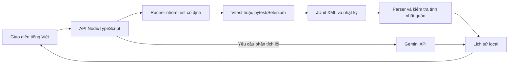

# Kiểm thử tự động website hỗ trợ học tiếng Trung và xây dựng công cụ tích hợp AI hỗ trợ phân tích kết quả

**Định hướng đã chốt:** đánh giá chất lượng website HSK là trọng tâm môn học; HSK Test Lab là sản phẩm hỗ trợ do dự án phát triển. Đây là hồ sơ kỹ thuật và thực nghiệm dùng làm nguồn cho bài chính thức theo [bố cục sáu chương](REPORT-OUTLINE.md), chưa phải bản thảo đầy đủ sáu chương.

Ngày cập nhật tài liệu: **20/10/2026, múi giờ UTC+7**. Số liệu thực nghiệm dưới đây thuộc đợt **19/10/2026**; lần cập nhật này đối chiếu minh chứng và bổ sung truy vết, bảng lỗi, tiêu chí kết luận, không chạy lại website. JSON minh chứng dùng timestamp UTC.

**Kết quả Selenium mới nhất:** toàn bộ **85 ca đã chạy: 75 PASS, 10 FAIL, 0 ERROR/SKIP**, thời gian runner 1727,746 giây. Nhóm tra từ/sổ tay chạy riêng bằng UI và CLI đều **10/10 PASS**, từng ca khớp nhau. **85/85 ca hiển thị trong lịch sử khớp XML gốc.** [Báo cáo Selenium chi tiết, phân loại lỗi và minh chứng](SELENIUM-RESULTS.md). Kết nối website hiện tại được giữ nguyên.

## 1. Mục tiêu và phạm vi thực tế

Mục tiêu chính là đánh giá các hành vi website HSK được bộ test hiện có kiểm tra: xác thực, từ vựng/flashcard, mở khóa, ôn tập, tiến độ/thống kê/cách ly dữ liệu, luyện viết, trò chơi và tra từ/sổ tay. Kết luận phải nối yêu cầu với ca kiểm thử, kết quả và minh chứng, đồng thời phân biệt lỗi đã có nguyên nhân với phát hiện cần xác minh. [Bảng chốt kết quả và môi trường](EVIDENCE-BASELINE.md) là nguồn dùng thống nhất giữa các chương.

Công cụ `ai-test-tool` điều phối các test Vitest/Selenium **đã có**, đọc JUnit XML, hiển thị kết quả, lưu lịch sử và dùng Gemini giải thích lỗi/gợi ý bước kiểm tra. Không sinh test bằng AI, không đánh giá assertion đúng sai và không sửa chức năng website HSK. Phạm vi này là yêu cầu đã được điều chỉnh so với đề xuất sinh test ban đầu.

Câu hỏi đánh giá chính: **website HSK đáp ứng các hành vi mong đợi trong phạm vi đã kiểm thử đến mức nào, và những rủi ro nào còn mở?** Dùng E-S02 (85 Selenium) và E-V01 (22 Vitest) theo bảng minh chứng; không lấy 21 test công cụ thay kết quả website.

Hai câu hỏi thực nghiệm cho sản phẩm hỗ trợ:

1. **Công cụ có chạy và tổng hợp đúng không?** So sánh số ca và trạng thái từng ca với XML gốc, có parser đối chiếu độc lập.
2. **AI có giúp giải thích lỗi không?** Đối chiếu nguyên nhân và các bước kiểm tra AI đề xuất với nguyên nhân đã xác định trước.

## 2. Yêu cầu và thiết kế

| Mã yêu cầu | Yêu cầu | Cách đáp ứng | Minh chứng triển khai |
| --- | --- | --- | --- |
| TOOL-01 | Chọn test có sẵn | Danh sách cố định: 3 nhóm Vitest và 9 nhóm Selenium; không nhận lệnh shell tùy ý từ UI | `src/config.ts`, `src/runner.ts` |
| TOOL-02 | Thực thi và kiểm soát tiến trình | Node spawn không dùng shell, một nhóm/lần, timeout 10–7200 giây; hủy cây tiến trình | `src/runner.ts` |
| TOOL-03 | Tổng hợp kết quả có căn cứ | Đọc `testcase/failure/error/skipped`, đối chiếu bộ đếm suite; thiếu XML không tính PASS | `src/junit.ts` |
| TOOL-04 | Giao diện và lịch sử | Chọn nhóm, chạy/dừng, lọc ca, chi tiết lỗi, nhật ký, nhập/tải XML, tìm lịch sử | `public/`, `src/server.ts` |
| TOOL-05 | Lưu theo lần chạy | UUID, JSON ghi qua tệp tạm rồi đổi tên, XML/log/ảnh riêng | `src/store.ts`, `data/runs/` |
| TOOL-06 | Gemini tùy chọn | Key phía server, chỉ gọi khi yêu cầu phân tích, dữ liệu lỗi được rút gọn/che một số thông tin nhạy cảm | `src/gemini.ts`, `src/redact.ts` |
| TOOL-07 | Không dùng DB website để chạy Selenium | File test riêng, kiểm tra endpoint khác, snapshot HSK và marker môi trường | `src/hsk-test-environment.ts`, `src/hsk-test-server.ts` |

### 2.1. Truy vết yêu cầu, ca kiểm thử và minh chứng

[Ma trận truy vết](TEST-TRACEABILITY.md) nối từng yêu cầu TOOL-01…07 và HSK-AUTH/VOC/UNLOCK/REVIEW/PROGRESS/WRITE/GAME/NOTE tới **21 ca công cụ, 22 ca Vitest và 85 ca Selenium**, với tên ca gốc, kết quả, nguồn và mã lỗi. Đây là mã truy vết được bổ sung khi lập báo cáo, không phải đặc tả nghiệp vụ mới hoặc bằng chứng bao phủ toàn bộ yêu cầu website.

Nguồn kết quả website là XML gốc của từng lượt; nguồn kết quả công cụ là nhật ký test đã lưu. Không cộng các lượt UI/CLI, các nhóm con hoặc XML lịch sử vào lượt 85 ca. Bảng lỗi dùng mã HSK-001…004, tương ứng **1 + 7 + 1 + 1 = 10 ca FAIL**. TOOL-001 là lỗi launcher đã sửa và kiểm tra lại ở lượt khác, không nằm trong 10 ca này.

Selenium chỉ khởi chạy khi HSK ở cổng 3000 trả marker khớp launcher kiểm thử. Launcher đọc `.env.hsk-test`, từ chối endpoint trùng website hiện tại (kể cả pooled/unpooled), và không sao chép `.env*` của HSK sang snapshot. Cấu hình gốc không bị thay đổi. Đã xác minh snapshot khởi động và kết nối endpoint kiểm thử thật. Lượt đầu lỗi cwd khi đọc `public/data` được dừng, sửa launcher rồi chạy lại; không sửa source website.

## 3. Môi trường, dữ liệu và cách hiểu số lượng

Mốc phiên bản cần đọc cùng [EVIDENCE-BASELINE.md](EVIDENCE-BASELINE.md): metadata ghi HEAD `197b22007f208b3fc9fd77ebfca3d22aecd18f0c` khi công cụ còn ở working tree; launcher thay đổi giữa các lượt. `ce3290af09456590f2b98a9dcfcb51a7320f25b6` là commit lưu trữ mã và minh chứng sau thực nghiệm, không phải một clean commit được chứng minh đã chạy toàn bộ đợt đó. Các hash nguồn theo giai đoạn và SHA-256 tệp minh chứng được giữ riêng, không bổ sung metadata hồi tố vào XML/JSON cũ.

| Con số | Ý nghĩa đúng |
| --- | --- |
| 18/18 | Bộ kiểm tra công cụ ở mốc triển khai đầu tiên |
| 21/21 | Bộ công cụ hiện tại, bổ sung 3 kiểm tra cách ly môi trường HSK |
| 22 ca Vitest | Kiểm tra logic website HSK, do công cụ điều phối; tách biệt với 21 test công cụ |
| 85 ca Selenium | Đã thực thi đủ: **75 PASS, 10 FAIL**; không phải 85 ca đạt |
| 70 XML / 115 bản ghi testcase | Báo cáo lịch sử có ca trùng giữa các lần chạy; không phải 70 lần chạy mới hay 115 test độc lập |

Node 24, Vitest 2.1.9 của HSK, Python 3.14, pytest/Selenium trong `.venv` riêng. Mã nguồn/cấu hình kiểm thử HSK không được sửa trong đợt này. Thu thập Selenium chỉ nhập module/thu thập ca, không mở fixture trình duyệt hoặc ghi database. [Nhật ký thu thập 85 ca](../experiments/2026-10-19/selenium-collection.log).

Database hiện tại được người dùng xác nhận là database website đang sử dụng, không được phép ghi/xóa cho kiểm thử. Vì vậy không khởi động HSK với kết nối đó và không chạy các ca Selenium trên nó. Người dùng đã cung cấp endpoint kiểm thử khác; cấu hình `.env.hsk-test` được kiểm tra trước khi chạy. Kết nối chỉ đọc ban đầu xác nhận 12 bảng và 0 tài khoản; sau đó các test tạo dữ liệu riêng. Xem [hướng dẫn môi trường](NEON-TEST-SETUP.md) và [metadata lượt Selenium](../experiments/2026-10-19/selenium-environment.json).

## 4. Kết quả theo sáu bước

| Bước | Kết quả thực tế | Trạng thái |
| --- | --- | --- |
| 1. Kiểm tra Gemini | Key mới gọi `generateContent` thành công HTTP 200, phân tích lỗi FC-05 lịch sử; lưu nội dung và thời gian | Đã thực hiện |
| 2. Chạy Selenium qua UI | Nhóm nhỏ 10/10 PASS; lượt đầy đủ 75 PASS/10 FAIL, đủ 85 ca; API và DOM khớp XML gốc | Đã thực hiện, có lỗi website/tương tác được ghi nhận |
| 3. Tình huống lỗi | XML hỏng, hủy, timeout và từ chối kết nối đều khớp mong đợi; có thêm kiểm tra UI từ chối XML và Selenium chưa cách ly | Đã thực hiện trong phạm vi công cụ |
| 4. So sánh lệnh/UI | Vitest 22/22 PASS mỗi cách; Selenium nhóm nhỏ 10/10 PASS mỗi cách, từng ca giống nhau; thời gian tách riêng | Đã thực hiện trên một lượt mỗi cách |
| 5. Đánh giá AI | 10 mẫu có nguyên nhân đối chiếu, lưu câu trả lời; chấm sơ bộ 7 đúng/3 đúng một phần. Một lần 503 được thử lại và giữ lịch sử lỗi | Đã làm mẫu nhỏ, chưa chấm độc lập |
| 6. Báo cáo | Bổ sung yêu cầu, kiến trúc, kiểm tra lỗi, số liệu, đầy đủ 85 ca Selenium và giới hạn kèm minh chứng | Báo cáo này và báo cáo Selenium chi tiết |

### 4.1. Gemini bằng key mới

Nguồn: `selenium-tests/FC-05-results.xml`, lỗi lịch sử `100%` khác chuỗi kỳ vọng `100`. Đây là nguyên nhân trực tiếp khiến phép so sánh thất bại, không đủ để kết luận cần sửa website hay assertion. Gemini giải thích được sự khác biệt và đề nghị đối chiếu đặc tả/DOM. Key không được lưu trong minh chứng hoặc mã nguồn.

[Kết nối và nội dung phân tích](../experiments/2026-10-19/gemini-connection.json). Bản nhập và phân tích thành công cũng được lưu vào lịch sử local với run ID trong tệp này. Lỗi 403 từng gặp với key trước không phải kết quả của key mới.

### 4.2. XML và tổng hợp kết quả

Python ElementTree được dùng làm parser đối chiếu độc lập. Trên cùng 70 XML gốc, **70/70 khớp số ca và trạng thái từng ca**, tổng 115 bản ghi. Một testcase trong `VOC-level-results.xml` không có thuộc tính `name`: công cụ hiển thị nhãn `Không có tên`; quy tắc này được ghi rõ khi so sánh và không thêm testcase.

[Đối chiếu từng tệp, hash và số lượng](../experiments/2026-10-19/xml-compatibility.json). Kết quả này kiểm chứng tính nhất quán khi nhập báo cáo, không khẳng định website hiện tại chạy đạt các báo cáo lịch sử.

### 4.3. Các tình huống lỗi

| Tình huống | Mong đợi | Thực tế |
| --- | --- | --- |
| XML sai cấu trúc | Từ chối, không sinh lịch sử PASS giả | Từ chối; UI thông báo lỗi và số lịch sử giữ nguyên |
| Hủy tiến trình | Dừng cây tiến trình, trạng thái cancelled | cancelled; tiến trình Node fixture có kiểm soát |
| Hết 10 giây | Dừng tiến trình, timeout, không tính PASS | timeout sau 10,588 giây; fixture Node cố ý không kết thúc |
| Mất kết nối khi phân tích | Trả lỗi và giữ trạng thái test | ECONNREFUSED; giữ error, dùng endpoint local đã đóng, không phải mất mạng Gemini thật |
| Chưa có HSK kiểm thử | Không tạo pytest/không ghi DB website | UI hiển thị error có nguyên nhân; không có command/XML hoặc ca Selenium được chạy |

[Kết quả mong đợi/thực tế](../experiments/2026-10-19/fault-scenarios.json), [minh chứng UI và chặn môi trường](../experiments/2026-10-19/ui-guard.json), [ảnh UI](../experiments/2026-10-19/selenium-test-environment-required.png). Các fixture Node/HTTP phục vụ kiểm tra công cụ, không phải lỗi website HSK mới được phát hiện.

### 4.4. Thời gian chạy bằng lệnh và qua UI

Cùng hai tệp `core.test.ts` và `gate.test.ts`, chạy nối tiếp một lượt bằng lệnh và một lượt qua UI. Python ElementTree đối chiếu XML, API và tên/trạng thái ca hiển thị trên giao diện: **22/22 giống nhau**, đều PASS. File `.env.local` HSK có hash trước/sau giống nhau.

| Đại lượng | Dòng lệnh | Giao diện |
| --- | ---: | ---: |
| Số ca / PASS / FAIL / ERROR / SKIP | 22 / 22 / 0 / 0 / 0 | 22 / 22 / 0 / 0 / 0 |
| Thời gian do Vitest ghi trong XML | 0,582 s | 0,653 s |
| Thời gian tiến trình/runner | 3,942 s | 2,181 s |
| Chọn nhóm + bấm chạy bằng tự động hóa | Chưa đo | 0,194 s |
| Từ thao tác tự động đến khi hiển thị đủ ca | Chưa đo | 6,855 s |
| Thu thập thông tin DOM bằng tự động hóa | Không áp dụng | 0,743 s |

[Số liệu đầy đủ](../experiments/2026-10-19/cli-ui-comparison.json), [XML lệnh](../experiments/2026-10-19/vitest-cli.xml), [XML UI](../experiments/2026-10-19/vitest-ui.xml), [nhật ký lệnh](../experiments/2026-10-19/vitest-cli.log), [nhật ký UI](../experiments/2026-10-19/vitest-ui.log), [ảnh UI](../experiments/2026-10-19/vitest-ui.png).

Chưa đo thời gian thao tác/tổng hợp của người dùng bằng tay. Thời gian tự động hóa không thay thế thời gian con người. Khác biệt giữa hai lượt có thể do cache/khởi động/chu kỳ polling; **không kết luận UI làm Selenium chạy nhanh hơn**, cũng chưa suy ra hiệu quả tiết kiệm thao tác từ một cặp lượt Vitest.

### 4.5. Đánh giá AI

Ground truth và bước kiểm tra phù hợp được lưu **trước** lời gọi AI, không đưa vào prompt. Bộ mẫu có 1 lỗi HSK lịch sử và 9 lỗi tạo có kiểm soát: môi trường, assertion, timeout, xác thực/phân quyền và DB. Đánh giá cả nguyên nhân lẫn hành động, mỗi mục 0–2; `2+2` là đúng, tổng ít nhất 2 nhưng chưa `2+2` là đúng một phần, còn lại là sai.

| Mẫu | Nguyên nhân đã biết | Nhận xét sơ bộ |
| --- | --- | --- |
| AI-01 | 100% khác 100 trong FC-05 lịch sử | Đúng |
| AI-02 | Thiếu Python module được cố ý import | Đúng |
| AI-03 | Đường dẫn executable không tồn tại, ENOENT | Đúng |
| AI-04 | Node assertion 79 khác 80 | Đúng một phần: nguyên nhân đúng, suy đoán thêm DB/HSK thiếu căn cứ |
| AI-05 | setInterval giữ tiến trình, runner timeout | Đúng |
| AI-06 | Client timeout 30 ms trước HTTP fixture phản hồi | Đúng |
| AI-07 | HTTP 401 do thiếu token | Đúng một phần: có bước đúng nhưng suy diễn engine import thực thi HTTP |
| AI-08 | HTTP 403 do role learner thiếu quyền admin | Đúng một phần: phân biệt quyền đúng, vẫn suy diễn engine import |
| AI-09 | Cổng local đã đóng, ECONNREFUSED trước xác thực DB | Đúng |
| AI-10 | DATABASE_URL test chưa điền, launcher dừng | Đúng |

[Tập lỗi và nguyên nhân](../experiments/2026-10-19/ai-dataset.json), [toàn bộ phản hồi](../experiments/2026-10-19/ai-responses.json), [rubric/điểm/nhận xét](../experiments/2026-10-19/ai-judgements.json).

Một yêu cầu AI-08 đầu tiên trả HTTP 503; không chấm lỗi dịch vụ thành câu trả lời sai. Thử lại riêng mẫu đó thành công và giữ `previousAttempts`. Model được cấu hình bằng alias `gemini-flash-latest`; metadata retry ghi nhận `gemini-3.8-flash`. Các mẫu trước chưa lưu modelVersion nên có giới hạn tái lập. Tên mẫu AI-08 ở script retry bị mất dấu qua PowerShell; hiện tượng này được giữ trong phản hồi, không chỉnh lời AI để làm đẹp kết quả.

Đây là **chấm sơ bộ bởi trợ lý Codex**, chưa có người đánh giá độc lập. Không xem 7/10 là tỷ lệ chính xác tổng quát của Gemini; chưa lặp nhiều lượt, chưa đo thời gian người dùng tiết kiệm, và phần lớn mẫu là lỗi có kiểm soát. Các gợi ý không có bằng chứng được ghi nhận là hạn chế thay vì mặc nhiên chấp nhận.

Đến lần cập nhật 20/10/2026, **chưa có kết quả chấm độc lập**. [Phiếu và quy trình chấm độc lập](AI-INDEPENDENT-REVIEW.md) đã chuẩn bị với 10 hàng chưa chấm; không dùng một lần tự chấm lại của trợ lý làm người chấm độc lập. Số 7 đúng/3 đúng một phần chỉ mô tả tập mẫu và rubric này; không công bố “Gemini chính xác 70%”.

## 5. Kiểm tra công cụ và giới hạn còn lại

TypeScript/cú pháp JavaScript đạt. [Nhật ký kiểm thử công cụ](../experiments/2026-10-19/tool-tests.log) ghi nhận 21/21 đạt; 3 ca bổ sung kiểm tra cấu hình thiếu, endpoint trùng và endpoint kiểm thử khác. Bộ này kiểm tra công cụ, không thay thế 22 ca logic HSK hoặc 85 ca Selenium. Mốc 18/18 trong tài liệu trước là mốc ban đầu.

Sau đợt Selenium đã chạy lại và giữ kết quả **21/21 đạt**: [nhật ký cuối đợt](../experiments/2026-10-19/tool-tests-after-selenium.log). [Đối chiếu cuối đợt](../experiments/2026-10-19/verification-final.json) xác nhận hash kết nối website không đổi, DOM/XML khớp, nhóm nhỏ CLI/UI khớp và Gemini HTTP 200.

Đã thực hiện: HSK snapshot với endpoint Neon kiểm thử thật, nhóm nhỏ qua UI, đủ 85 ca, đối chiếu CLI/UI cho nhóm nhỏ và phân tích Gemini trên lỗi thực tế. Còn lại: khắc phục các phát hiện rồi kiểm tra lại, đo thao tác người dùng thật, chấm AI độc lập và đo độ ổn định nhiều lượt. Không ghi những hạng mục chưa làm là đạt.

## 6. Bước tiếp theo

Ưu tiên xử lý các phát hiện trong [bảng lỗi](DEFECT-REGISTER.md), bắt đầu bằng xác minh tương tác nút quay về và khắc phục tên khoảng trắng, lịch bỏ sót ngày hiện tại; thu thập thêm log cho NOTE-04. Mức độ nghiêm trọng và ưu tiên là nhận định phục vụ xử lý, chưa phải mức do chủ sản phẩm phê duyệt. Chưa thay chức năng website hoặc assertion để đổi kết quả. Đợt khắc phục cần được xác định phạm vi, chạy lại các ca liên quan và giữ lượt 75/85 làm bằng chứng trước sửa. Chỉ đóng lỗi khi có mã sửa và lượt kiểm tra lại liên kết rõ; lượt PASS nhóm nhỏ không tự đóng HSK-004.

## 7. Thực nghiệm Selenium trên môi trường riêng

Lượt đầy đủ run ID `04d381c9-e06b-453e-9601-2a698141b34a`: **75 PASS / 10 FAIL / 0 ERROR / 0 SKIP**, runner 1727,746 s; XML khai báo 1722,011 s. Bốn nhóm lỗi: REG-09 chấp nhận tên khoảng trắng (1), click nút quay lại cấp HSK bị chặn (7), lịch không có ô ngày hiện tại (1), NOTE-04 timeout chờ UI rỗng dù API đã xóa (1). Hai nguyên nhân đầu vào tên và cửa sổ ngày đã được kiểm tra thêm bằng source/truy vấn chỉ đọc/chạy trực tiếp hàm. Các giả thuyết race của sổ tay chưa được chứng minh.

| Đại lượng cùng nhóm tra từ/sổ tay | CLI | UI nhóm nhỏ |
| --- | ---: | ---: |
| Tổng / PASS / FAIL / ERROR / SKIP | 10 / 10 / 0 / 0 / 0 | 10 / 10 / 0 / 0 / 0 |
| Thời gian khai báo XML | 153,517 s | 178,580 s |
| Thời gian tiến trình/runner | 155,019 s | 180,279 s |

Tên/classname/trạng thái từng ca giống nhau. [Số liệu đối chiếu](../experiments/2026-10-19/selenium-cli-ui-comparison.json). UI chạy trước CLI, không reset DB giữa hai lượt; cache, tải hệ thống và lượng dữ liệu có thể khác. Không đo thao tác con người và không kết luận UI làm test nhanh hơn. Cùng nhóm này nằm trong lượt đầy đủ chỉ đạt 9/10 vì NOTE-04; kết quả chạy lại không thay thế FAIL của lượt đầy đủ.

[Minh chứng độc lập XML/API/DOM](../experiments/2026-10-19/selenium-dom-verification.json) cho thấy 85/85 ca được hiển thị đúng khi mở từ lịch sử. [Gemini phân tích lỗi thực tế](../experiments/2026-10-19/selenium-gemini-analysis.json) thành công HTTP 200; giả thuyết AI vẫn cần xác minh, tách biệt với tập chấm 10 mẫu ở mục 4.5.

## 8. Kết luận chất lượng theo tiêu chí và phạm vi chưa kiểm thử

### 8.1. Công cụ hỗ trợ kiểm thử

Đối với câu hỏi “công cụ có chạy và tổng hợp đúng không”, bằng chứng hiện có **đáp ứng trong các tình huống đã kiểm tra**: 21/21 test công cụ đạt, luồng chọn/chạy/đọc XML/lưu/mở lại hoạt động, 85/85 ca hiển thị khớp XML, 70/70 XML lịch sử khớp parser đối chiếu. Các lỗi hủy/timeout/XML hỏng/kết nối thất bại được kiểm tra riêng. Kết quả này không chứng minh mọi đầu vào hoặc mọi môi trường đều đúng.

Đối với câu hỏi “AI có giúp giải thích lỗi không”, HTTP 200 và phản hồi được lưu chứng minh chức năng tích hợp hoạt động. Đánh giá sơ bộ cho thấy một số gợi ý hữu ích nhưng còn suy đoán thiếu căn cứ; **chưa đủ bằng chứng về độ chính xác tổng quát hoặc thời gian tiết kiệm**. Cần người chấm độc lập theo phiếu ở mục 4.5 và thực nghiệm thao tác con người.

### 8.2. Website HSK

Đối chiếu các tiêu chí định tính đã nêu trong [README của dự án](../../README.md), phần “Ghi nhận kết quả và tiêu chí đánh giá”. Chưa có ngưỡng nghiệm thu định lượng được thống nhất trước thực nghiệm; báo cáo không đặt thêm ngưỡng tỷ lệ PASS sau khi xem kết quả.

| Tiêu chí đã nêu | Bằng chứng đợt 19/10/2026 | Kết luận trong phạm vi |
| --- | --- | --- |
| Các luồng chức năng đáp ứng kết quả mong đợi | 75 PASS/10 FAIL trên 85 Selenium; 4 nhóm phát hiện đang mở | **Chưa đáp ứng đầy đủ** bộ E2E hiện có; 88,24% là tỷ lệ ca đạt của lượt này |
| Không làm hỏng hành vi đã được kiểm thử | 22/22 Vitest SM-2/mở khóa/ngưỡng điểm đạt; chưa chạy lại các bộ `hsk-app/tests` hồi quy/preservation trong đợt này | **Đạt ở 22 ca logic đã chạy; chưa đủ kết luận hồi quy toàn bộ** |
| Schema và dữ liệu kiểm thử hợp lệ | Kết nối endpoint riêng, quan sát 12 bảng, test thực thi được; chưa chạy lại bộ schema và các lệnh kiểm tra dữ liệu học tập | **Chưa đủ bằng chứng** cho toàn bộ tiêu chí schema/dữ liệu |
| Mã nguồn vượt qua kiểm tra tĩnh và build | TypeScript công cụ đạt; không có bộ log ESLint/TypeScript/production build đầy đủ của website trong đợt này | **Chưa đủ bằng chứng cho website**; không dùng kết quả công cụ thay kết quả HSK |
| Các ca bảo vệ dữ liệu hiện có đạt | Ca cookie và cách ly tài khoản trong lượt Selenium đạt; endpoint kiểm thử khác, hash cấu hình website giữ nguyên | **Đạt các ca đã chạy**, chưa phải kiểm định bảo mật toàn hệ thống hoặc xác minh branch qua Neon management API |

Website còn hai phát hiện chức năng đã có căn cứ (HSK-001, HSK-003), một nhóm tương tác cần xác minh phạm vi ảnh hưởng (HSK-002) và một phát hiện UI chưa ổn định (HSK-004). Vì vậy **chưa đủ cơ sở nghiệm thu chất lượng toàn website**. Các ca PASS chỉ xác nhận hành vi được assertion hiện có kiểm tra, không khẳng định đặc tả hoặc mọi tình huống nghiệp vụ đều đúng.

### 8.3. Phạm vi chưa có kết luận trong đợt này

- Chưa kiểm thử E2E đầy đủ các module chủ đề, đọc hiểu, hội thoại, phát âm, luyện thi, ngữ pháp và chất lượng gia sư AI của website. Gemini trong công cụ là chức năng khác với gia sư AI HSK.
- Chưa chạy lại JMeter/đánh giá tải, độ bền hoặc đặt ngưỡng thời gian phản hồi; các file `PERF` là minh chứng lịch sử, không thuộc kết quả mới ở đây.
- Chưa có kiểm thử đa trình duyệt, E2E trên thiết bị di động hoặc accessibility; kiểm tra bố cục mobile của công cụ không thay thế kiểm thử website trên mobile.
- Chưa có kiểm định bảo mật chuyên biệt, phục hồi/backup, code coverage được xác nhận, hoặc bộ kiểm tra schema/dữ liệu/build website đầy đủ cho đợt này.
- Chưa chạy lại toàn bộ sau sửa lỗi website; chưa đo độ ổn định nhiều lượt và biên ngày/tháng/năm cho lịch thống kê. Lượt CLI/UI không reset DB nên không phải cặp môi trường dữ liệu hoàn toàn giống nhau.
- Chưa chấm AI độc lập, chưa lặp đủ phản hồi và chưa đo thời gian thao tác/tổng hợp của người dùng thật. Không suy ra độ chính xác chung hoặc mức tăng tốc Selenium.

Các phần chưa kiểm thử được ghi **chưa đủ bằng chứng**, không gộp vào PASS, FAIL hoặc tỷ lệ bao phủ.
